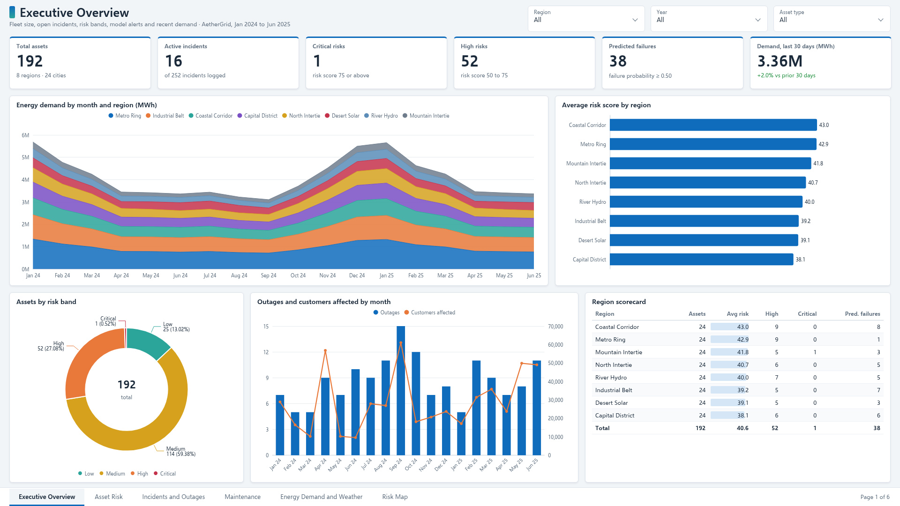
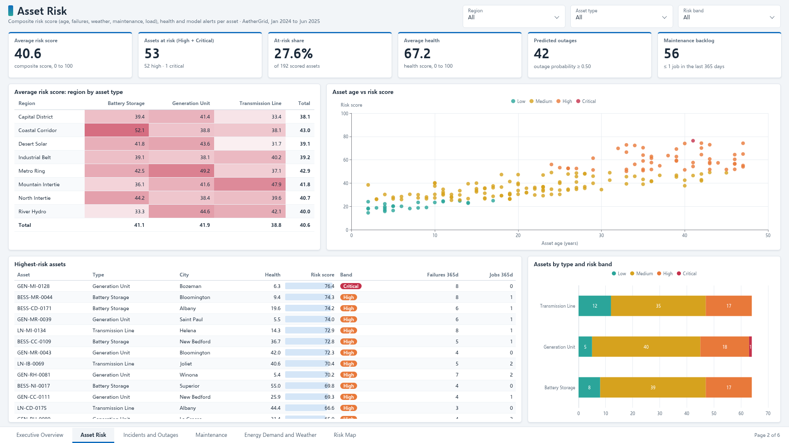
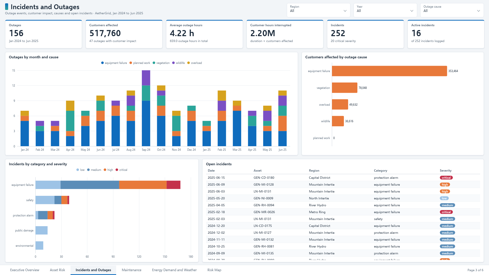
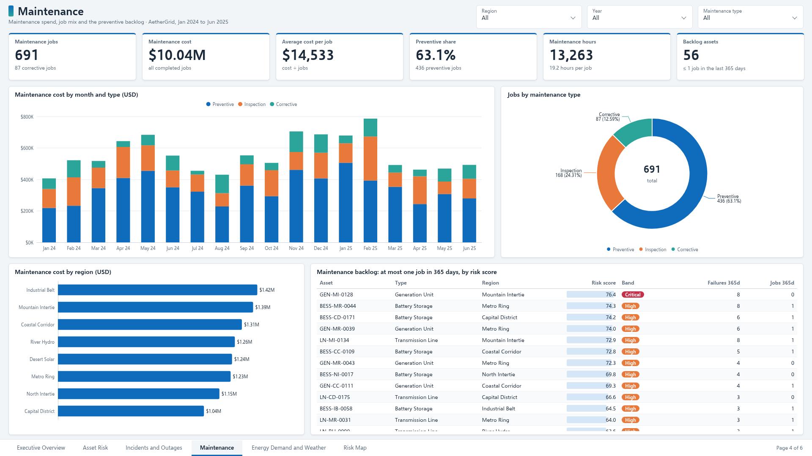
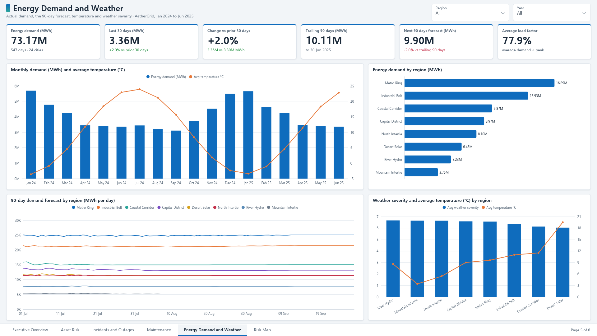
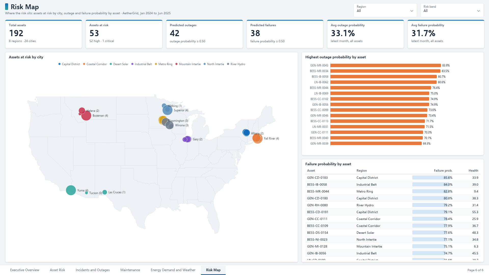

# Critical Infrastructure Risk Intelligence Platform

AetherGrid's control-center system for asset risk, outages, maintenance, and energy demand. It is a seeded demonstration grid — 192 assets, 8 regions, January 2024 through June 2025 — built so the warehouse, the models, and the console all read the same numbers.

The operator console is the working surface. Power BI uses the same star schema.

## What you can do

- See total assets, open incidents, critical and high risks, and 30-day demand.
- Rank assets by a composite score (age, failures, weather, maintenance, load) and by outage and failure probability.
- Map risk, shock weather or load, and read which bands move.
- Forecast the next 90 days of energy and compare it with the trailing quarter.
- Ask which regions are hottest, what caused recent outages, which assets need preventive work, and what demand is coming. The answer is computed from the warehouse. An OpenAI-compatible model can rewrite that brief when `OPENAI_API_KEY` is set.

## Demonstration snapshot

From the seeded grid after bootstrap (model registry `1.0.1`):

| | |
| --- | --- |
| Assets | 192 |
| Open incidents | 16 |
| Critical / high risk | 1 / 52 |
| Failure probability ≥ 0.50 | 38 assets |
| Outage probability ≥ 0.50 | 42 assets |
| Highest average risk | Coastal Corridor, then Metro Ring |
| Trailing 90-day demand | 10.11 million MWh |
| Next 90-day forecast | 9.90 million MWh |

Holdout metrics:

| Model | Result |
| --- | --- |
| Outage | ROC AUC 0.72, recall 0.54, precision 0.10 at a 0.50 threshold |
| Failure | ROC AUC 0.79, recall 0.60, precision 0.21 |
| Demand | RMSE 234 MWh, MAE 170 MWh on the last 45 days |
| Health | RMSE 7.8 points, MAE 6.7 points |
| Anomaly | ROC AUC 0.995, F1 0.88 against injected sensor faults |

The outage threshold favors recall. Outages are uncommon, so a crew list at 0.50 will include false alarms. Use the ranking together with the composite score. Full definitions are in [docs/kpis.md](docs/kpis.md) and [docs/features.md](docs/features.md).

## Run it

```bash
python -m venv .venv
source .venv/bin/activate
pip install -r requirements.txt
export PYTHONPATH=src
python -m ciri bootstrap
python -m uvicorn api.main:app --port 8766
python -m streamlit run streamlit_app/app.py --server.port 8765 --server.address 0.0.0.0
```

- Console: http://127.0.0.1:8765
- API docs: http://127.0.0.1:8766/docs

Leave `DATABASE_URL` unset to use SQLite at `data/warehouse/ciri.db`. Postgres and Docker are in [docs/deployment.md](docs/deployment.md).

```bash
pytest
```

## Console

| Page | What it shows |
| --- | --- |
| Executive Overview | Assets, open incidents, critical risks, predicted failures, demand |
| Asset Monitoring | Health, filters, one-asset explanation against the fleet median |
| Risk Intelligence | Map, correlation, weather and load scenario |
| Forecasting | 90-day demand, outage probability, failure probability |
| AI Assistant | The four operating questions, plus a free-text box |
| Incident Explorer | Causes, categories, outage trend, report text |

## Power BI Dashboard

A six-page Power BI report on the same star schema: [`dashboards/powerbi/CriticalInfraRisk.pbip`](dashboards/powerbi/CriticalInfraRisk.pbip), with a TMDL semantic model that loads the CSV extracts in `dashboards/powerbi/extracts/`.

[Dashboard walkthrough (56 s)](dashboards/powerbi/dashboard-walkthrough.mp4)

| | |
| --- | --- |
| **Executive Overview**: 192 assets, 16 open incidents, 1 critical and 52 high-risk assets, 38 predicted failures, 3.36M MWh in the last 30 days (+2.0%)  | **Asset Risk**: average risk 40.6, 53 assets at risk (27.6%), average health 67.2, 42 predicted outages, region by asset type matrix, highest-risk assets  |
| **Incidents and Outages**: 156 outages, 517,760 customers affected, 4.22 h average, causes by month, open incidents  | **Maintenance**: 691 jobs, $10.04M, 63.1% preventive, 56 assets in the backlog  |
| **Energy Demand and Weather**: 73.17M MWh actual, trailing 90 days 10.11M against a 9.90M forecast, temperature and weather severity  | **Risk Map**: assets at risk by city, outage and failure probability by asset  |

It answers where risk sits, which assets are likely to fail next, what caused outages, where maintenance money goes, and what demand is coming. Equipment failure caused 80 of the 156 outages and 68% of customers affected, and GEN-MI-0128, the only critical asset, had 8 failures in a year with no maintenance job.

To open it, load `CriticalInfraRisk.pbip` in Power BI Desktop, set the `DataFolder` parameter to your local `dashboards/powerbi/extracts` path (Transform data > Edit parameters), and refresh. Pages, KPIs and model notes are in [dashboards/powerbi/README.md](dashboards/powerbi/README.md).

## Layout

```
critical-infrastructure-risk-intelligence/
├── api/                  FastAPI
├── dashboards/powerbi/   Power BI project, extracts, DAX, screenshots
├── data/                 raw, processed, quarantine, sqlite warehouse
├── docs/                 architecture, flow, features, KPIs, impact, deploy
├── models/               joblib artifacts, registry, experiment log
├── notebooks/            warehouse and model notes
├── sql/                  star schema and KPI views
├── src/ciri/             generate, ETL, risk, models, analyst
├── streamlit_app/        operator console
├── tests/
├── Dockerfile
└── docker-compose.yml
```

## Documentation

- [Architecture](docs/architecture.md)
- [Data flow](docs/data-flow.md)
- [Features](docs/features.md)
- [KPIs](docs/kpis.md)
- [Business impact](docs/business-impact.md)
- [Deployment](docs/deployment.md)
- [Power BI](dashboards/powerbi/README.md)

## Stack

Python, pandas, NumPy, scikit-learn, FastAPI, Streamlit, Plotly, SQL, PostgreSQL (optional), SQLite (local default), Docker, GitHub Actions. The analyst calls any OpenAI-compatible `/chat/completions` endpoint.
