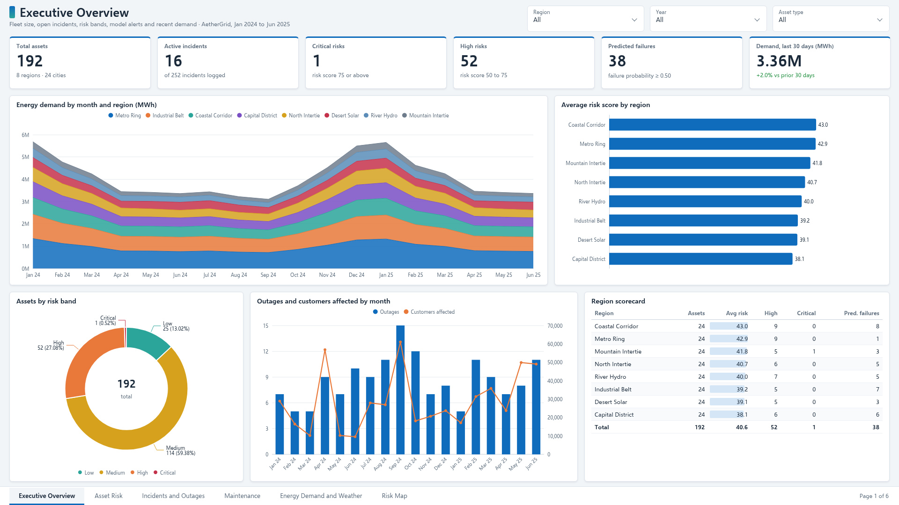
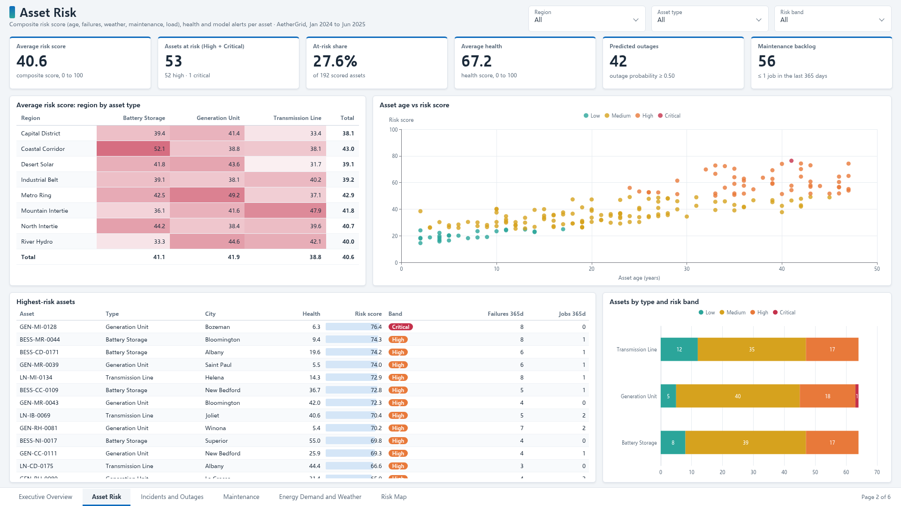
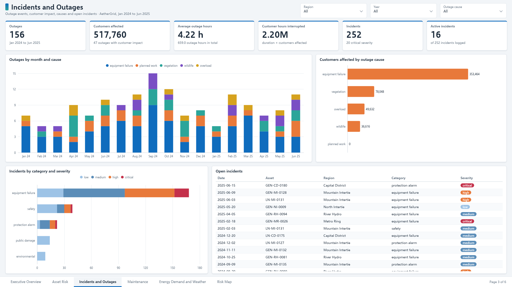
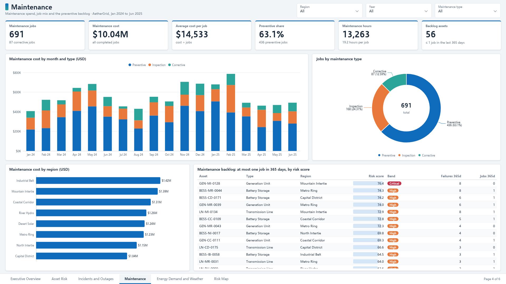
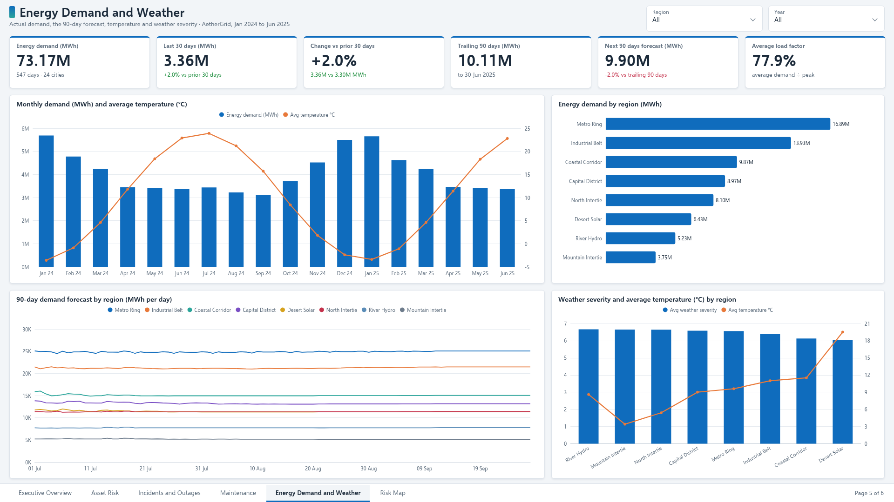
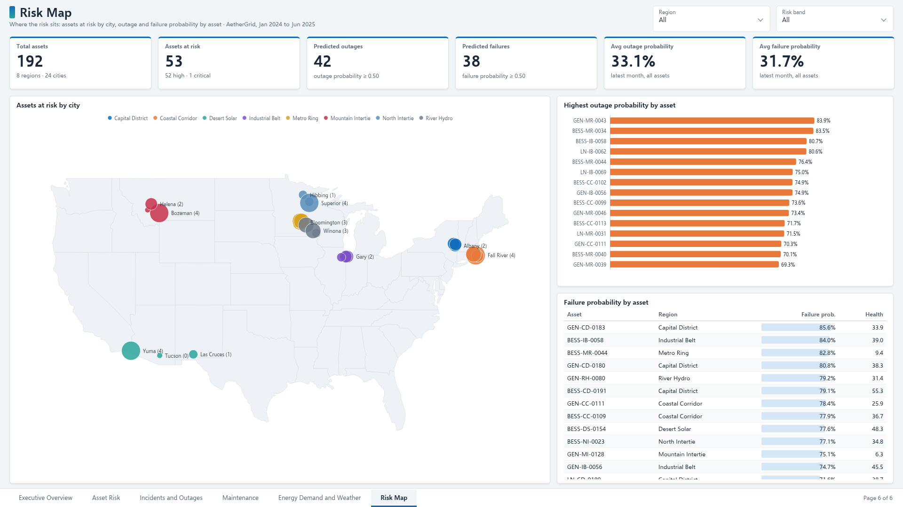

# Power BI

The three dashboards below are the semantic model for Power BI Desktop. The same views are implemented in the Streamlit console so they can be opened without Power BI. Extracts are written to `extracts/` on every ETL run. Postgres users can ignore the CSVs and connect to the tables in `sql/`.

## Power BI Dashboard

`CriticalInfraRisk.pbip` is the finished Power BI project: a TMDL semantic model over the extracts in this folder and a six-page report that covers the executive, operations and forecast dashboards specified further down. To build the model by hand instead, follow [Connect](#connect). The walkthrough and screenshots use the seeded demonstration grid (192 assets, January 2024 through June 2025).

[Dashboard walkthrough (56 s)](./dashboard-walkthrough.mp4)

### Business questions

- Where does asset risk sit by region, city and asset type, and which assets are at the top?
- Which assets are most likely to have an outage or an equipment failure next month?
- What caused the outages, and how many customers did they reach?
- Is maintenance going to the assets that need it, and what does it cost?
- How is demand moving, and what does the next quarter look like against the last one?

### Dashboard pages

| | |
| --- | --- |
| **1. Executive Overview**: assets, open incidents, critical and high risks, predicted failures, 30-day demand; demand by month and region, risk by region, risk bands, outages by month, region scorecard  | **2. Asset Risk**: average risk and health, assets at risk, predicted outages, backlog; region by asset type matrix, age against risk score, highest-risk assets, risk bands by asset type  |
| **3. Incidents and Outages**: outages, customers affected, outage hours, customer hours interrupted; outages by month and cause, customers by cause, incidents by category and severity, open incidents  | **4. Maintenance**: jobs, cost, cost per job, preventive share; cost by month and type, job mix, cost by region, the preventive backlog  |
| **5. Energy Demand and Weather**: total, 30-day and trailing 90-day demand against the 90-day forecast; monthly demand with temperature, demand by region, forecast by region, weather severity by region  | **6. Risk Map**: assets at risk by city on a map, outage and failure probability by asset  |

Every page has a region slicer and a year, asset type, cause or risk band slicer.

### Key KPIs

| KPI | Value |
| --- | --- |
| Total assets | 192 in 8 regions, 24 cities |
| Active incidents | 16 of 252 |
| Critical / high risk | 1 / 52 (27.6% of assets) |
| Average risk score | 40.6 |
| Average health score | 67.2 |
| Predicted failures / outages (probability ≥ 0.50) | 38 / 42 |
| Outages | 156, 517,760 customers affected, 4.22 h on average |
| Customer hours interrupted | 2.20 million |
| Maintenance | 691 jobs, $10.04M, $14,533 per job, 63.1% preventive |
| Maintenance backlog (at most one job in 365 days) | 56 assets, 28 of them high or critical |
| Energy demand | 73.17 million MWh in total |
| Last 30 days | 3.36 million MWh, +2.0% on the prior 30 days |
| Trailing 90 days / next 90 days forecast | 10.11 / 9.90 million MWh (-2.0%) |

### What the dashboard shows

- Coastal Corridor (43.0) and Metro Ring (42.9) carry the highest average risk score; Capital District is lowest at 38.1. Transmission lines score lower (38.8) than generation units (41.9) and battery storage (41.1).
- Equipment failure caused 80 of the 156 outages and 353,464 of the 517,760 customers affected (68%). September 2024 had the most outages, 15.
- GEN-MI-0128 in Mountain Intertie is the only critical asset (score 76.4). It had 8 failures in the last 365 days and no maintenance job, so it heads the backlog.
- GEN-MR-0043 has the highest outage probability (83.9%) and GEN-CD-0183 the highest failure probability (85.6%).
- Metro Ring uses the most energy, 16.89 million of the 73.17 million MWh. The next 90 days are forecast 2.0% below the trailing 90 days.

### Open in Power BI Desktop

1. Clone the repo and open `dashboards/powerbi/CriticalInfraRisk.pbip` in Power BI Desktop. On older Desktop builds, turn on the Power BI Project (.pbip) and TMDL preview features first.
2. Go to **Transform data > Edit parameters** and set `DataFolder` to the full path of your local `dashboards/powerbi/extracts` folder, for example `C:\critical-infrastructure-risk-intelligence\dashboards\powerbi\extracts`. Power Query needs an absolute path, so this is the only path to change; every table reads its CSV from that folder.
3. Click **Refresh**.

### Model notes

- 14 tables: the ten extracts written by the ETL plus four model score files, `Ml_OutageScore`, `Ml_FailureScore`, `Ml_HealthScore` and `Ml_DemandForecast`. The score files hold the outputs of model registry `1.0.1` (latest month June 2025, forecast 1 July to 28 September 2025).
- The relationships follow the table below. The `location_id` links from the asset-level facts and `Mart_AssetRisk`, and the `weather_id` links from the facts, are inactive so each filter has one path; assets already carry their location. `Mart_AssetRisk` to `Dim_Asset` is one-to-one, so the risk band slicer also filters incidents, outages, maintenance and model scores.
- `Dim_Date` is marked as the date table. The 30 and 90-day demand measures are anchored on the last date with demand, so they do not move with the year slicer.
- Measures live in the `_Measures` table, grouped in display folders. The first 14 are the ones in `measures.dax`; the additional KPIs from [docs/kpis.md](../../docs/kpis.md) are appended to the same file.

## Connect

1. Open Power BI Desktop.
2. Get data, Text/CSV, and load every file in `extracts/`. Promote headers.
3. Or get data from PostgreSQL (`localhost:54329`, database `ciri`) after `docker compose up`.
4. Model the relationships below.
5. Create the measures in `measures.dax`.
6. Build the three pages. Field lists match the Streamlit pages.

## Relationships

| From | To |
| --- | --- |
| `Fact_Outages.asset_id` | `Dim_Asset.asset_id` |
| `Fact_Outages.location_id` | `Dim_Location.location_id` |
| `Fact_Outages.date_key` | `Dim_Date.date_key` |
| `Fact_Outages.weather_id` | `Dim_Weather.weather_id` |
| `Fact_Incidents.asset_id` | `Dim_Asset.asset_id` |
| `Fact_Incidents.location_id` | `Dim_Location.location_id` |
| `Fact_Incidents.date_key` | `Dim_Date.date_key` |
| `Fact_EnergyDemand.location_id` | `Dim_Location.location_id` |
| `Fact_EnergyDemand.date_key` | `Dim_Date.date_key` |
| `Fact_Maintenance.asset_id` | `Dim_Asset.asset_id` |
| `Fact_Maintenance.location_id` | `Dim_Location.location_id` |
| `Fact_Maintenance.date_key` | `Dim_Date.date_key` |
| `Mart_AssetRisk.asset_id` | `Dim_Asset.asset_id` |
| `Mart_AssetRisk.location_id` | `Dim_Location.location_id` |
| `Ml_HealthScore.asset_id` | `Dim_Asset.asset_id` |
| `Ml_OutageScore.asset_id` | `Dim_Asset.asset_id` |
| `Ml_FailureScore.asset_id` | `Dim_Asset.asset_id` |
| `Dim_Asset.location_id` | `Dim_Location.location_id` |
| `Dim_Weather.location_id` | `Dim_Location.location_id` |
| `Dim_Weather.date_key` | `Dim_Date.date_key` |

Filter the date table on the fact tables. Do not filter `Mart_AssetRisk` by date; it is the current score.

## Executive dashboard

Cards: Total Assets, Active Incidents, Critical Risks, Predicted Failures, Energy Demand MWh.

Visuals:

- Stacked area of Energy Demand MWh by `Dim_Date` month and `Dim_Location.region`.
- Bar of Average Risk Score by region.
- Donut of assets by `Mart_AssetRisk.risk_label`.
- Slicers: region, year.

## Operations dashboard

- Table of asset name, type, city, health, risk score, risk label, failures, maintenance jobs.
- Map: `Dim_Location` latitude and longitude, bubble color = risk label. Power BI's map visual uses the location columns on `Mart_AssetRisk` directly.
- Heatmap (matrix): region by asset type, values = Average Risk Score.
- Line of Outage Count by month.
- Clustered bar of outage cause.
- Card: Maintenance Cost.

## Forecast dashboard

- Card: Forecast MWh (sum of `Ml_DemandForecast`).
- Line of `forecast_mwh` by `full_date`, legend region (join location).
- Bar of top 15 `Ml_OutageScore.outage_probability` by asset name.
- Card: Predicted Failures.
- Table of failure probability with region.

`Dim_RiskLevel` is the band lookup (min and max score) if you want a calculated column instead of the stored label. The stored `risk_label` is the one the API uses, so prefer it.
