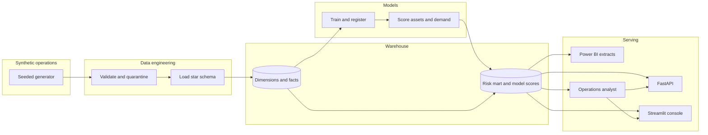

# Architecture

AetherGrid's risk platform is one Python codebase with a warehouse in the middle. The operator console and the HTTP API read the same tables the models write. Power BI reads the same star schema through CSV extracts or a Postgres connection.

## Boundaries

| Piece | Responsibility | Does not |
| --- | --- | --- |
| `ciri.data` | Build a seeded grid: assets, weather, demand, outages, incidents, maintenance, sensors | Train models |
| `ciri.etl` | Quality gates, quarantine, SQL load, Power BI extracts | Change business rules inside the generator |
| `ciri.risk` | Explainable 0–100 score and Low / Medium / High / Critical bands | Replace the failure model |
| `ciri.ml` | Five models, metrics, stored scores | Serve HTTP |
| `ciri.llm` | Answer from a warehouse brief; optional OpenAI-compatible call | Invent numbers |
| `api` and `streamlit_app` | Read the warehouse | Refit models on each page view |

## Runtime

Locally the warehouse is SQLite (`data/warehouse/ciri.db`). `DATABASE_URL` points the same code at PostgreSQL. The SQL in `sql/` is valid for both.

Model files live in `models/` next to `registry.json` and `experiments.jsonl`. A training run bumps the patch version.
