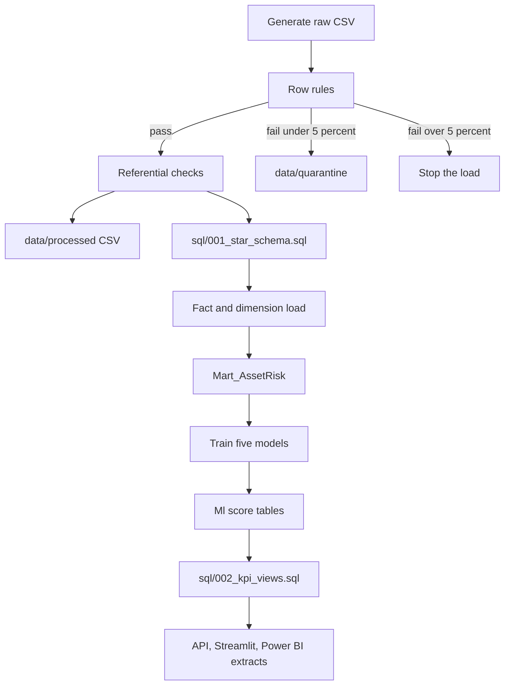

# Data flow

## Grain

| Table | Grain |
| --- | --- |
| `Dim_Asset` | One physical asset |
| `Dim_Location` | One city inside a control region |
| `Dim_Date` | One calendar day |
| `Dim_Weather` | One location-day |
| `Dim_RiskLevel` | One band definition |
| `Fact_Outages` | One customer interruption |
| `Fact_Incidents` | One filed report |
| `Fact_EnergyDemand` | One location-day of energy |
| `Fact_Maintenance` | One work order |
| `Ops_SensorReading` | One asset-day of condition readings. Operational store, not a star fact |
| `Fs_AssetMonth` | One asset-month feature row for training |
| `Mart_AssetRisk` | One current score per asset |
| `Ml_DemandForecast` | One location-day over the next 90 days |

## Quality gates

Negative durations, negative demand, and impossible coordinates are quarantined. If more than 5 percent of a table fails, the load stops. Facts that point at a missing asset, location, or date stop the load even if every individual row looked fine.

Logging goes to the console and to `logs/ciri.log`.
